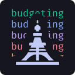
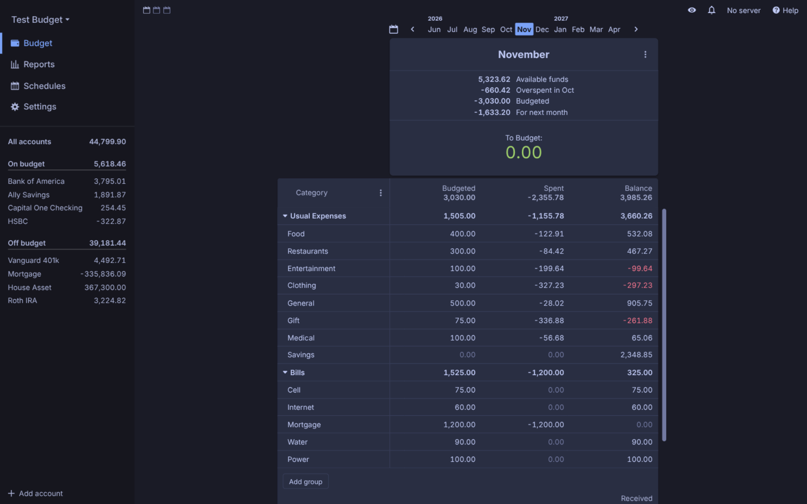
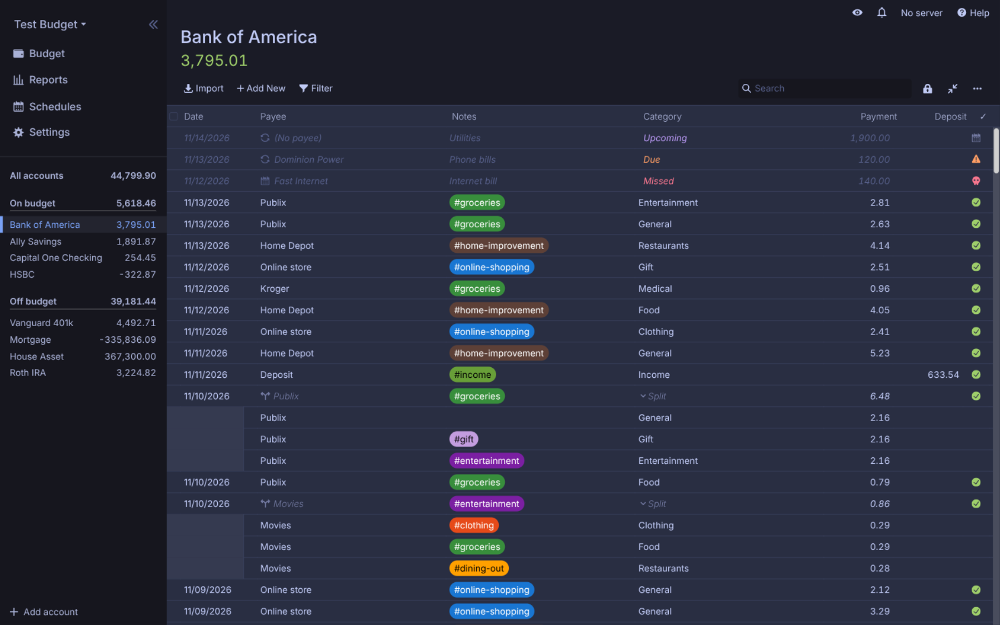
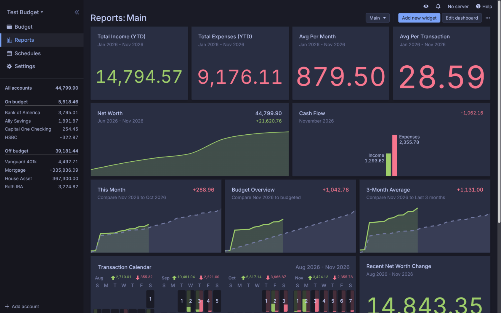
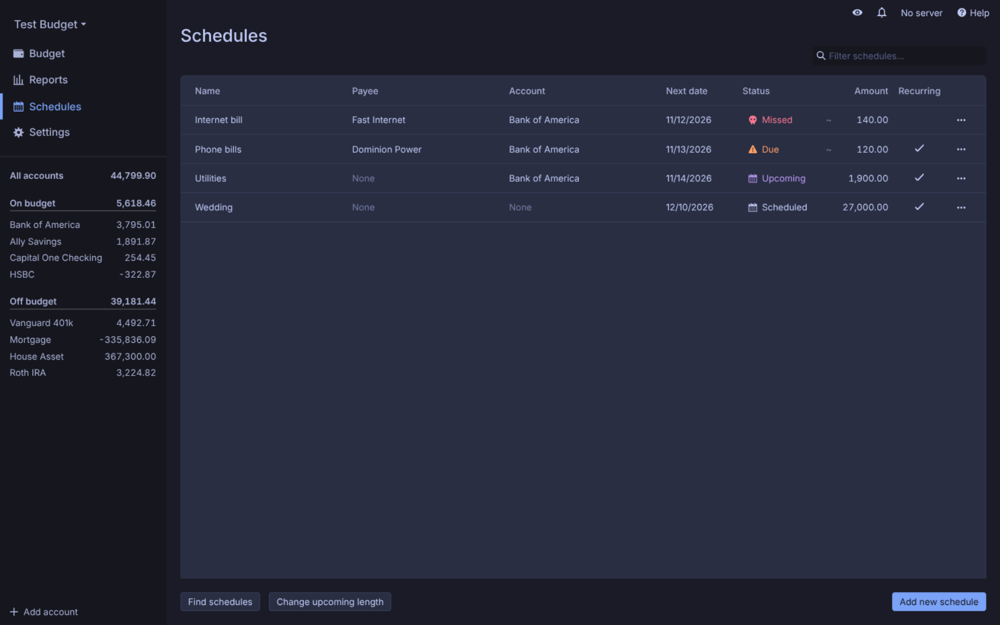

<p align="center"></p>

# Tokyo Night for Actual Budget

The [Tokyo Night](https://github.com/tokyo-night/tokyo-night-vscode-theme) colour scheme as a custom theme for [Actual Budget](https://actualbudget.org). The colours come from the Night style of the [tokyonight.nvim](https://github.com/folke/tokyonight.nvim) palette. The theme is dark only.

## Screenshots

**Budget**



**Transactions**



**Reports**



**Schedules**



## Installation

Custom themes need Actual 26.6.0 or later.

### From the theme catalog

1. Go to **Settings → Themes**.
2. Select **Custom theme** in the theme list.
3. Select **Tokyo Night** in the catalog.

### Manual

1. Copy the contents of [`actual.css`](actual.css).
2. Go to **Settings → Themes → Custom theme**.
3. Paste the CSS into **Additional CSS overrides** and select **Apply**.

Actual applies the overrides on top of every theme, including **Light**. To remove the theme, clear the text area and select **Apply**.

## Font

The theme keeps Actual's own font. To use a different font, add a line such as this to **Additional CSS overrides**:

```css
:root {
  --font-family: 'JetBrains Mono', monospace;
}
```

The font must be installed on your device.

## Credits

- Enkia made the original [Tokyo Night](https://github.com/tokyo-night/tokyo-night-vscode-theme) theme for Visual Studio Code (MIT License). The logo of this repository reuses the background and tower of its icon; the license notice is inside `images/logo.svg`.
- [tokyonight.nvim](https://github.com/folke/tokyonight.nvim) by Folke Lemaitre is the Neovim port of Tokyo Night. The colour values in this repository come from its palette (Apache License 2.0).
- The layout of `actual.css` follows [Palenight for Actual](https://github.com/mafsi/palenight-actual).
